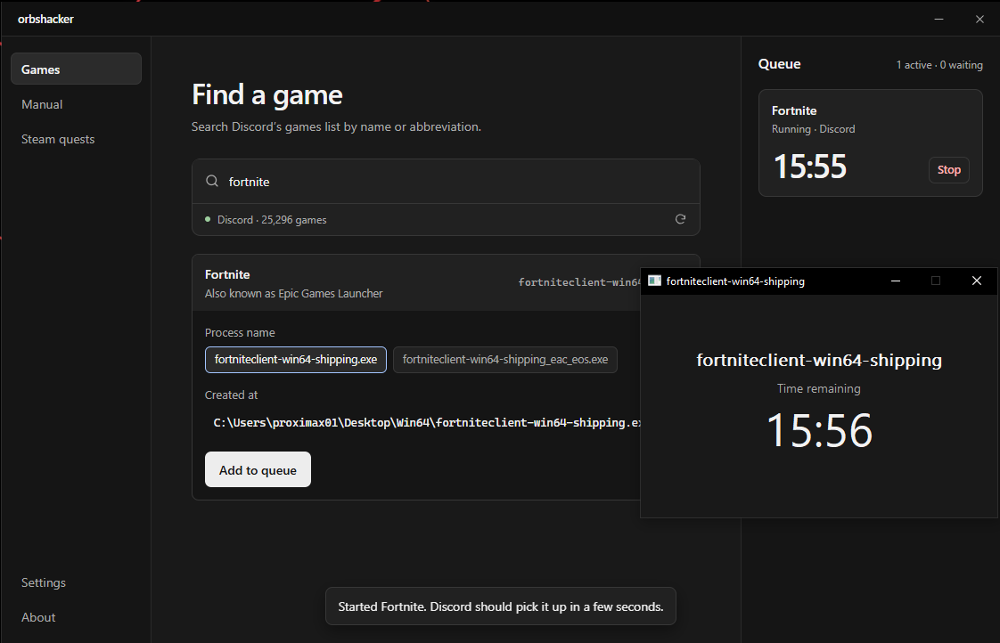
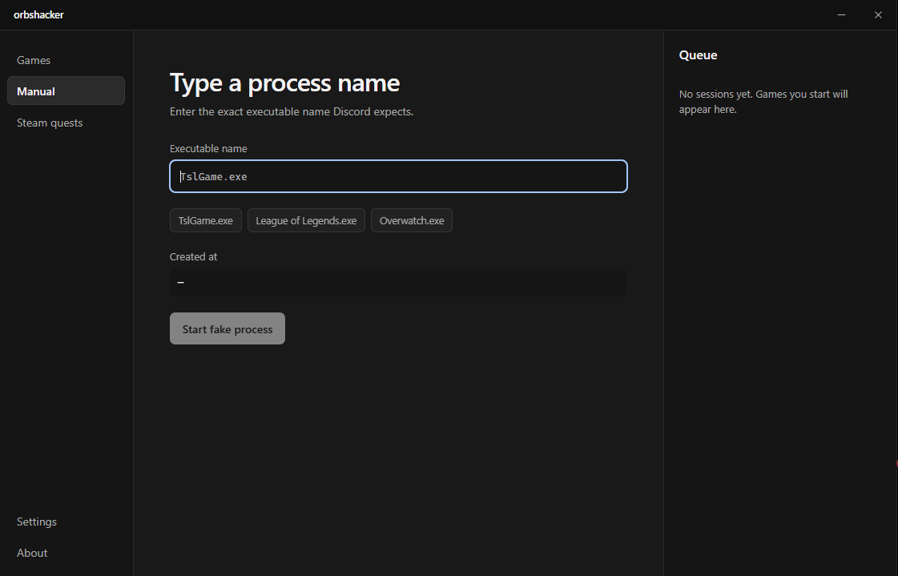

# Orbshacker UI

A dark Windows desktop interface for Orbshacker, built with Rust and Tauri.
Search the Discord game catalog, enter an executable name manually, or use
Steam quest mode.

[Automatic queue](#automatic-queue) · [Screenshots](#screenshots) · [Build and run](#build-and-run) · [Credits](#credits)

## Automatic queue

Add games to the queue while a session is running. Orbshacker runs one game at a
time in the order you added them. When the active session ends, the next game
starts automatically.

The Queue panel shows the remaining time for the active game and which games
are waiting. Sessions default to **16 minutes**, and you can change the duration
in Settings.

## Screenshots

### Game search and countdown



### Manual mode



## Build and run

### Requirements

- Windows with the Microsoft Edge WebView2 Runtime
- Rust with the MSVC toolchain
- Visual Studio C++ Build Tools and a Windows SDK

Run these commands from the repository root.

```powershell
cargo run --locked -p orbshacker
cargo build --release --locked -p orbshacker
```

The release executable is `target/release/orbshacker.exe`. Cargo embeds the
interface in the executable. The app stores `settings.json` next to the
executable when you save preferences.

## Project layout

- `ui/` contains the HTML, CSS, and JavaScript interface.
- `src-tauri/` contains the desktop window, native commands, and app assets.
- `crates/core/` contains session logic, the native countdown window, and tests.

## Tests

```powershell
cargo test --workspace --locked
```

## Credits

**Desktop UI** by Proximax1.

**Original project** by Strykey. [strykey/orbshacker](https://github.com/strykey/orbshacker)

See [LICENSE](LICENSE) for license terms and attribution.
